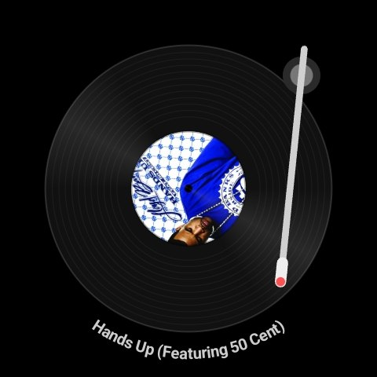
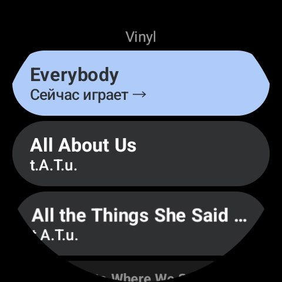
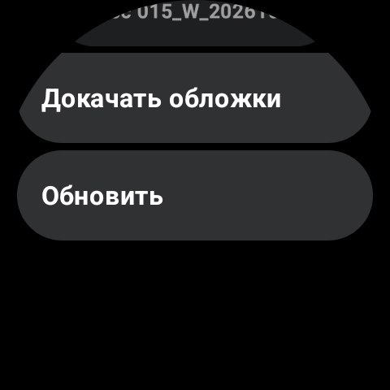
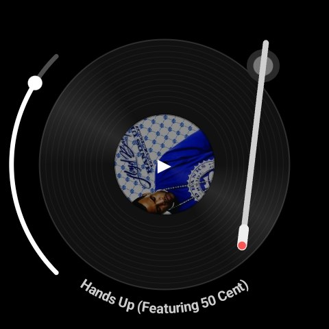

# VinylWatch — проигрыватель-вертушка для Wear OS (Galaxy Watch Ultra)

Вращающаяся пластинка, скретч пальцем, тонарм для перемотки, свайп назад к плейлисту.

## Сборка и запуск
1. Android Studio (свежая) → Open → папка `VinylWatch`. Sync. Если ругнётся на версии (AGP/Kotlin/Compose BOM/Wear Compose) — прими апгрейд, API не менялись принципиально.
2. Часы: Настройки → О часах → Программное обеспечение → 7 раз тапнуть по версии → Параметры разработчика → Отладка по Wi-Fi.
3. `adb pair <ip:port>` / `adb connect <ip:port>`, затем Run ▶ на часы.
4. Положить треки (mp3/m4a/ogg/flac/wav/opus) в память часов:
   `adb push *.mp3 /sdcard/Music/`
   При первом запуске приложение попросит доступ к музыке (READ_MEDIA_AUDIO). Если трек не появился в списке — нажми «Обновить» внизу списка (приложение попросит MediaStore проиндексировать /sdcard/Music), либо перезагрузи часы.
   Запасной путь без разрешений: `/sdcard/Android/data/app.vinylwatch/files/Music/` (или `run-as app.vinylwatch` → `files/music/`).
5. Обложки на часах: Galaxy Wearable при копировании может не переносить встроенные картинки. Тогда положи `<имя файла трека>.jpg` (256×256) в `/sdcard/Android/data/app.vinylwatch/files/covers/` (или рядом с треком, или `cover.jpg` в папку альбома) — приложение подхватит.
   Источники обложек по порядку: берутся из тегов файла; если их нет — `cover.jpg`/`folder.jpg`/`<имя трека>.jpg` рядом с файлом; иначе thumbnail MediaStore; иначе генерируется цветная этикетка. Кеш: `cache/covers` (256×256 WebP). Результат «обложки нет» тоже кешируется (`.none`) — чтобы пересканировать, очисти данные приложения.

## Управление
- Центр пластинки (этикетка) — play/pause.
- Палец на пластинке — она останавливается; крути по кругу вперёд/назад — скретч (реверс работает).
- Взять тонарм за любое место руки и двинуть — перемотка; звук на время переноса выключен, игла встаёт на отпускание.
- Навигация: список и пластинка — две страницы одной оси. С пластинки свайп вправо (от любой кромки вне диска) или кнопка Back — к списку; со списка свайп влево или строка «Сейчас играет →» — обратно к пластинке. Музыка не прерывается.
- Левая кромка: вертикальное движение вдоль дуги — громкость, горизонтальное вправо — назад к списку (направление решает жест).

## Устройство
- `Library` — треки из MediaStore (content://) + app-private папки (file://); `Covers` — извлечение/кеш/круглая маска обложки.
- `audio/PcmDecoder` — MediaExtractor+MediaCodec (из Uri) → стерео PCM16 в RAM.
- `audio/ScratchEngine` — AudioTrack (low-latency), указатель чтения с дробной скоростью; vel=1 играет, 0 стоп, <0 реверс. Мотор/торможение — экспоненциальное сглаживание.
- `ui/Geo` — геометрия диска и тонарма (прогресс трека ↔ угол руки).
- `ui/PlayerScreen` — рисование и жесты. Угол диска = позиция × 200°/с, т.е. картинка всегда совпадает со звуком.

## Докачка обложек
Кнопка «Докачать обложки» в списке (только по Wi-Fi): для треков без обложки ищет запись в MusicBrainz по тегам артист+название и берёт картинку из Cover Art Archive; сохраняет `files/covers/<имя файла трека>.jpg`. Не нашли — повтор не раньше чем через 14 дней. В `CoverFetcher.kt` контакт для MusicBrainz задан в USER_AGENT (CoverFetcher.kt).

## Энергопотребление (шаг 2)
- Два режима вывода: DEEP (POWER_SAVING, блоки ~46 мс, ~21 пробуждение/с; при нормальной скорости блок копируется arraycopy) и FAST (LOW_LATENCY, блоки ~6 мс) — только пока палец на пластинке и 4 с после.
- Пауза: поток засыпает через 0,5 с тишины и выводит `pause()+flush()` — 0 пробуждений.
- Угол диска считается по СЛЫШИМОЙ позиции (по `playbackHeadPosition` и кольцу блоков), а не по записанной.
- UI: 60 fps только при касании, ~30 fps при игре, ~7 Гц на паузе, цикл остановлен, если экран не RESUMED или ambient.
- Ambient: тонкие серые контуры, смещение раз в минуту.
- Сервис: `PlaybackService` (foreground, mediaPlayback) + `MediaSession`; Deck живёт в Application. Через 5 мин паузы Deck.stop() освобождает PCM и сервис завершается.

### Чем мерить (без этого оптимизации — гадание)
1. Эталон: стоковый плеер Samsung, тот же файл, 30 мин, экран погашен; затем наше приложение.
2. `adb shell dumpsys batterystats --reset` → играть → `adb shell dumpsys batterystats app.vinylwatch`; пробуждения — Perfetto (`sched`, `power`).
3. Проверить: нет ли пропусков звука при погашенном экране (DEEP-буфер ~140 мс; если CPU засыпает — добавить PARTIAL_WAKE_LOCK на время play).

## Не сделано (по приоритету)
1. Ongoing Activity (значок на циферблате), обложка в MediaSession-метаданных, кнопки в уведомлении.
2. Скачивание треков с сервера (WorkManager), приложение-компаньон для телефона.
3. Хаптика на скретче, обложки/теги (MediaMetadataRetriever), громкость (вращение безеля).
4. Передача треков с телефона (Data Layer) вместо adb push.

## Релизная сборка (APK, подписанный твоим ключом)
1. Один раз создай ключ (`keytool -genkeypair ...`), положи ВНЕ проекта и сделай копию в надёжном месте: потеряешь — обновления поверх уже не встанут.
2. Скопируй `keystore.properties.example` в `keystore.properties`, впиши путь и пароли.
3. `gradlew assembleRelease` -> `app/build/outputs/apk/release/app-release.apk`.
4. Проверка подписи: `apksigner verify --verbose --print-certs app-release.apk`.
Release и debug подписаны разными ключами: при переходе debug -> release приложение нужно удалить (`adb uninstall app.vinylwatch`; обложки из `files/covers` сохрани через `adb pull`).

## Screenshots

  
  
  
  

## License

[PolyForm Noncommercial 1.0.0](LICENSE): free for noncommercial use. For commercial use, contact the author via GitHub.
